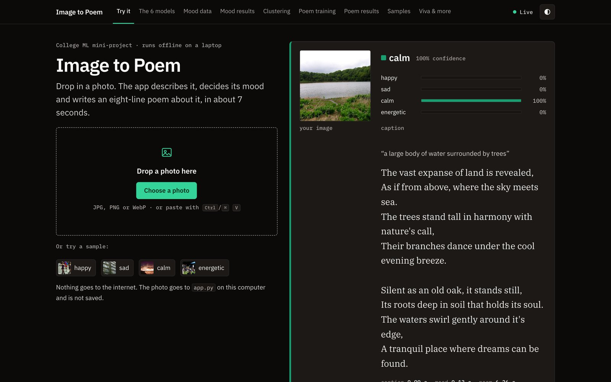
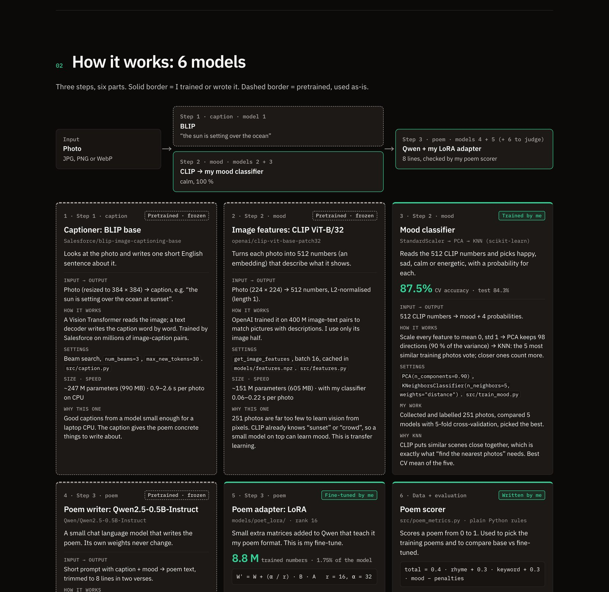
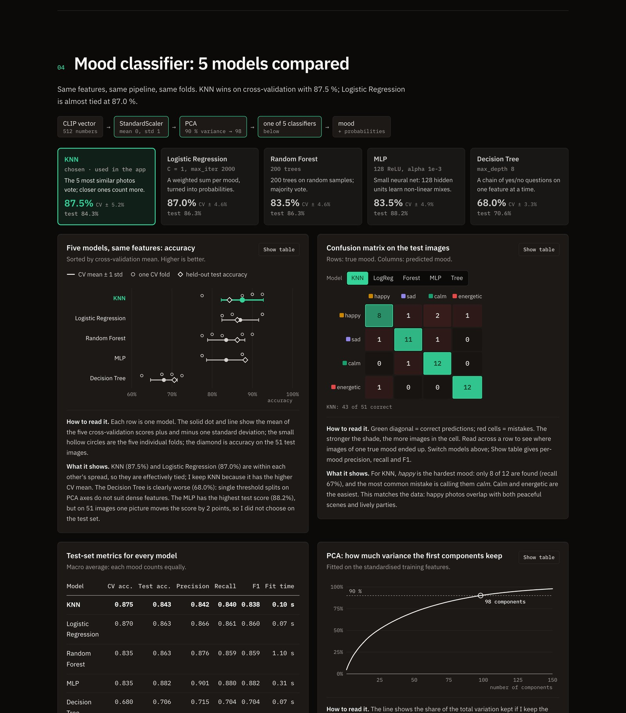
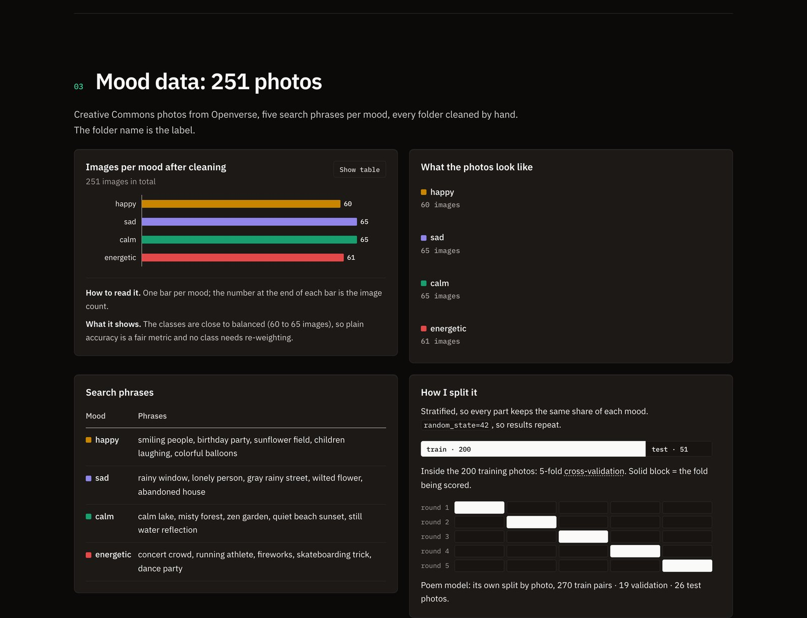
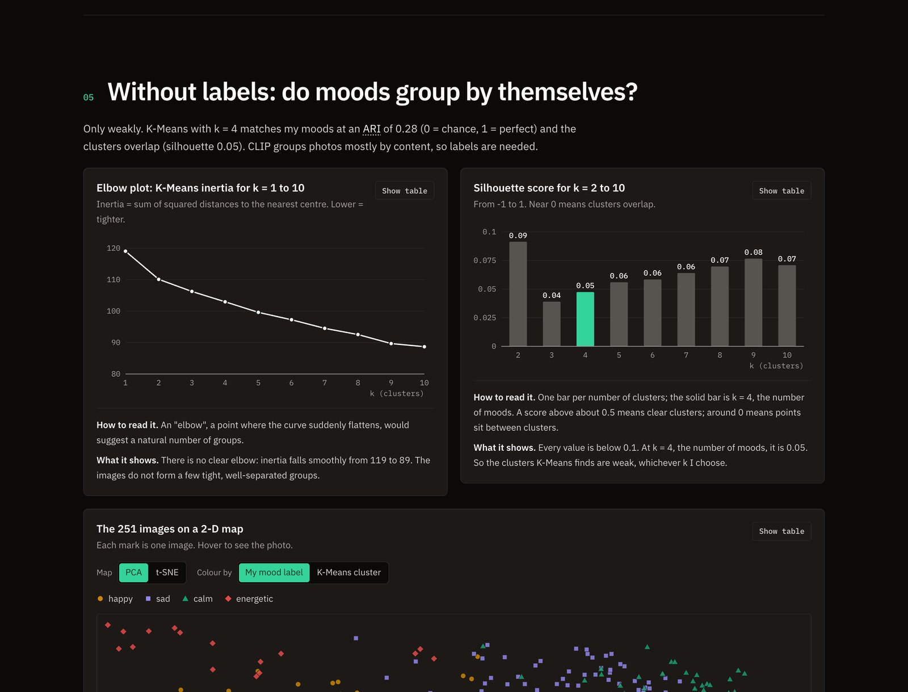
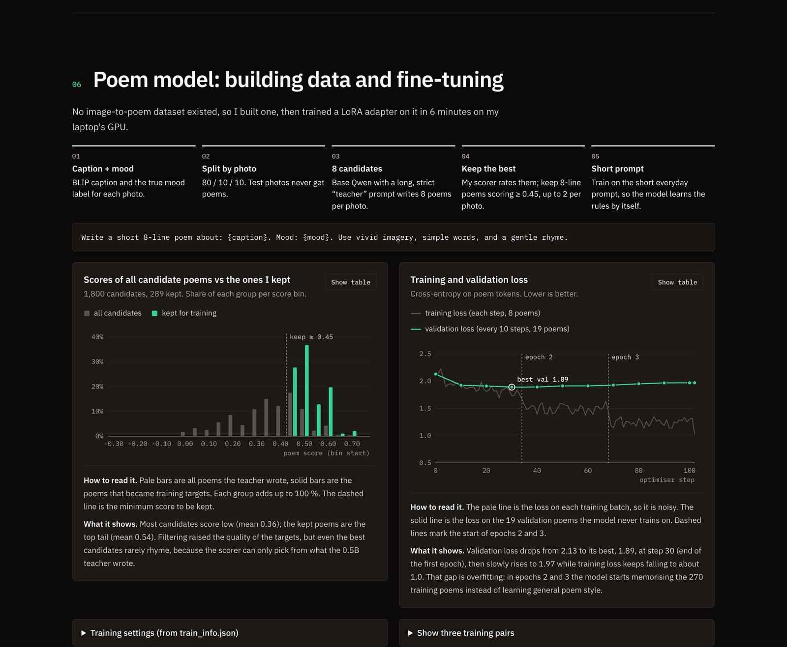
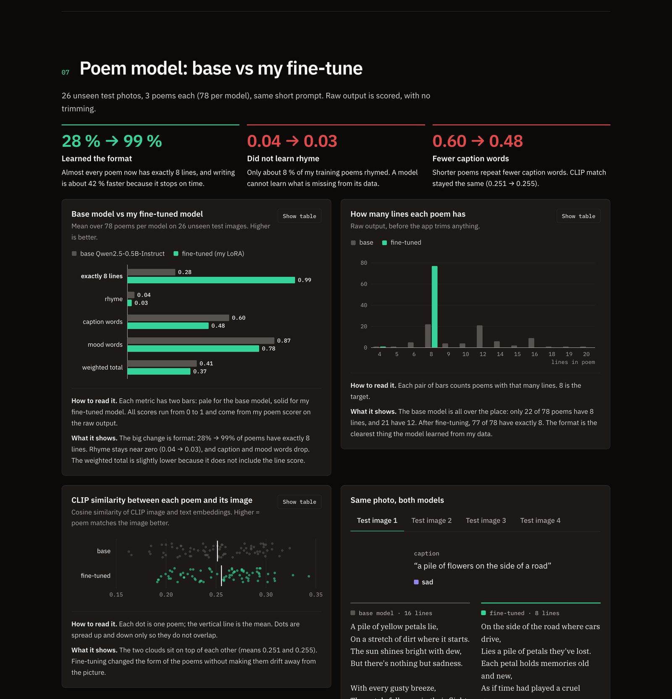
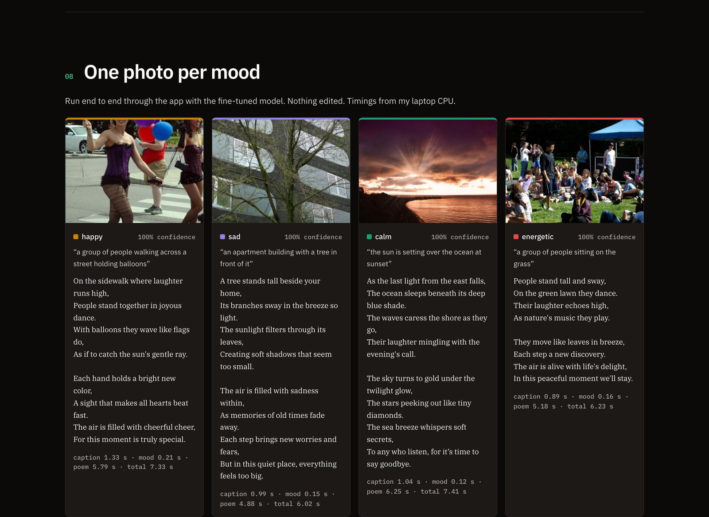
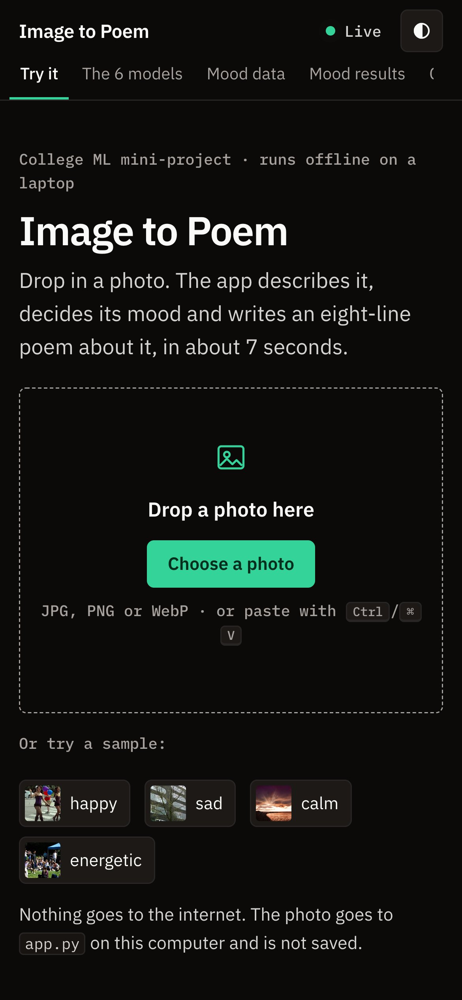
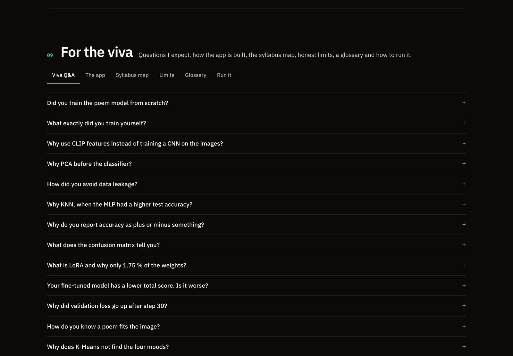

<h1 align="center">Image to Poem</h1>

<p align="center">
  <b>Drop in a photo. Get a caption, a mood and an eight-line poem, in about 7 seconds, offline on a laptop.</b><br>
  A college machine-learning mini-project: one classifier I trained from scratch, one language model I fine-tuned with LoRA.
</p>

<p align="center">
  
  
  
  
  
</p>

<p align="center">
  
</p>

---

## What it does

```
photo ──► BLIP (pretrained) ───────────────────────────────► caption ─┐
   │                                                                  ├─► my fine-tuned poet ─► 8-line poem
   └────► CLIP (frozen) ─► scale ─► PCA ─► my mood classifier ─► mood ─┘   (LoRA on Qwen2.5-0.5B-Instruct)
```

| Step | Model | Pretrained or mine? |
|---|---|---|
| 1. Caption | BLIP base (`Salesforce/blip-image-captioning-base`) | pretrained, frozen |
| 2. Image features | CLIP ViT-B/32 (`openai/clip-vit-base-patch32`), 512 numbers per photo | pretrained, frozen |
| 2. Mood | StandardScaler → PCA → **KNN**, best of 5 compared models | **trained by me from scratch** (scikit-learn) |
| 3. Poem | Qwen2.5-0.5B-Instruct + **my LoRA adapter** | base pretrained, adapter **fine-tuned by me** on 270 image→poem pairs I built |
| 3. Pick best | Poem scorer (rhyme, caption words, mood words, penalties) | **written by me** (plain Python rules) |

> Honest note: BLIP, CLIP and the base Qwen model are pretrained. I did not train a language model from scratch; I fine-tuned 1.75 % of its weights with LoRA. The mood classifier is trained from scratch.

## Headline numbers

| | |
|---|---|
| **251** photos | collected and labelled by hand, 4 moods, ~60 each |
| **87.5 %** | mood accuracy, KNN, 5-fold cross-validation (± 5.2 %) |
| **28 % → 99 %** | poems with exactly 8 lines, base → my fine-tune |
| **8.8 M of 503 M** | weights trained by LoRA (1.75 %), 6 minutes on a MacBook GPU |
| **~7 s** | per photo on a laptop CPU (caption + mood + best-of-3 poem) |

---

## A tour of the website

The project ships with a one-page website (served by `app.py`) that is both the demo and the write-up. All screenshots are dark mode.

### The six models, in pipeline order

Every part says what it does, its input and output, settings, size and speed, and whether it is pretrained or mine (green = mine).



### Mood classifier: 5 models compared

Same CLIP features, same pipeline, same folds. KNN wins on cross-validation; Logistic Regression is almost tied. The confusion matrix shows *happy* is the hardest mood.



<table>
<tr>
<td width="50%"><b>Mood data</b><br><sub>251 Creative Commons photos from Openverse, split 80/20, 5 folds.</sub><br></td>
<td width="50%"><b>Clustering (unsupervised)</b><br><sub>K-Means does not find the moods by itself (silhouette 0.05, ARI 0.28), so labels are needed.</sub><br></td>
</tr>
</table>

### Poem model: how I built the data and trained it



### Poem model: base vs my fine-tune

Green = better, red = worse. The model learned the format; it did **not** learn rhyme, because only 8 % of my training poems rhymed.



<table>
<tr>
<td width="68%"><b>Samples, one per mood</b><br></td>
<td width="32%"><b>Works on a phone</b><br></td>
</tr>
</table>

<details>
<summary><b>Viva Q&A, syllabus map, limits, glossary</b> (click)</summary>
<br>

</details>

---

## Quick start

```bash
python3.11 -m venv venv
source venv/bin/activate          # Windows: venv\Scripts\activate
pip install -r requirements.txt
python app.py                     # open http://127.0.0.1:7860
```

The first run downloads the pretrained models (~2.5 GB) to `~/.cache/huggingface`.
After that, everything works offline: `export HF_HUB_OFFLINE=1`.

| URL | What |
|---|---|
| http://127.0.0.1:7860/ | **website + Studio**: drop an image → caption, mood, poem, timing |
| http://127.0.0.1:7860/gradio | classic Gradio UI with **Regenerate poem** |
| `POST /api/poem` (field `image`) | JSON API: `curl -F image=@photo.jpg http://127.0.0.1:7860/api/poem` |

The API returns `{caption, mood, confidence, probs, poem, timing}`. If a model file is missing, the app stops with a clear message saying what to run.

## Train it yourself

### 1. Mood classifier (supervised + unsupervised)

```bash
python -m src.build_dataset --per-mood 60   # CC images from Openverse -> data/<mood>/
python -m src.features                      # CLIP embeddings -> models/features.npz
python -m src.train_mood                    # compare 5 models, save the best, plots
```

Check the images by hand (delete ones that don't fit the mood), then re-run the last two commands.

### 2. Poem model (supervised fine-tuning with LoRA)

Stop `app.py` first: it holds ~3 GB of models and training needs the RAM.

```bash
python -m src.poem_data    # build image -> poem pairs  (~1.5 h on Mac GPU, ~10 min on Colab T4)
python -m src.train_poet   # LoRA fine-tune             (~6 min on Mac GPU)
python -m src.eval_poet    # base vs fine-tuned on unseen test images
```

- **Dataset** (`src/poem_data.py`): each image is captioned; its mood comes from my folder labels. The base model writes 8 candidate poems with a long, strict "teacher" prompt. My scorer keeps the best one → 270 train / 19 val pairs. 26 test images get no poems. The split is by image, so nothing leaks. This is **rejection sampling / prompt distillation**.
- **Training** (`src/train_poet.py`): input = short prompt (caption + mood), target = poem, cross-entropy on poem tokens only. LoRA rank 16 on all attention + MLP layers. Effective batch 8 (4 × 2 gradient accumulation), gradient checkpointing, 3 epochs, lr 2e-4, cosine schedule.
- **No GPU?** `notebook/Train_on_Colab.ipynb` runs the same three steps on a free Colab T4.

### 3. Refresh the website

```bash
python -m src.make_samples   # 1 sample per mood (with timings) -> site/samples.json
python -m src.site_data      # all chart data -> site/data.json
python site/build_site.py    # -> site/index.html (14 interactive charts, light/dark)
```

The notebook `notebook/ImageToPoem.ipynb` tells the same story with 17 graphs, already executed.

---

## Results in detail

### Mood classifier (251 images, stratified 80/20 split + 5-fold CV)

| Model | 5-fold CV acc | Test acc | Test F1 |
|---|---|---|---|
| **KNN (chosen by CV)** | **0.875 ± 0.05** | 0.843 | 0.838 |
| Logistic Regression | 0.870 ± 0.05 | 0.863 | 0.860 |
| Random Forest | 0.835 ± 0.05 | 0.863 | 0.859 |
| MLP | 0.835 ± 0.05 | 0.882 | 0.882 |
| Decision Tree | 0.680 ± 0.03 | 0.706 | 0.704 |

PCA: 512 → 98 components keep 90 % of the variance. K-Means k=4: silhouette 0.05, ARI vs moods 0.28. Moods are not natural clusters, which is why supervised learning is needed. I chose by CV, not by test score: on 51 test images one photo moves the score by 2 points.

### Poem model (78 poems per model on 26 unseen test images)

| Metric | Base | Fine-tuned |
|---|---|---|
| Exactly 8 lines | 0.28 | **0.99** |
| Rhyming pairs | 0.04 | 0.03 |
| Uses caption words | 0.60 | 0.48 |
| Mood words | 0.87 | 0.78 |
| CLIP image↔poem similarity | 0.251 | 0.255 |
| Time for 78 poems (Mac GPU) | 194 s | **112 s** |

- **Overfitting:** val loss went 2.13 → 1.89 (best, step 30, about epoch 1), then rose to 1.97 while train loss kept falling to ~1.0. 270 pairs is a small dataset.
- **Learned:** the format. Two verses, exactly 8 lines, shorter and 42 % faster output.
- **Not learned:** rhyme. Only 8 % of the training poems rhymed. A model can only be as good as its data. Next step: rebuild the data keeping only rhyming candidates.
- **Best-of-3 at run time:** the app writes 3 poems in one batch and shows the one my scorer rates highest (`N_CANDIDATES` in `src/poem.py`). The model is unchanged; this is re-ranking. Mean score 0.36 → 0.40, rhyme 0.00 → 0.06, at about twice the poem time.
- **Speed** (16 GB Apple Silicon, CPU): caption ~1 s, mood ~0.1–0.3 s, poem ~5.5 s (best of 3) → **~7 s per image**.

## Syllabus map

| Syllabus module | Where | What to say in the viva |
|---|---|---|
| Preprocessing | `features.py`, `train_mood.py` | CLIP turns image → 512 numbers; L2-normalise; `StandardScaler`. |
| PCA | `train_mood.py`, `site_data.py` | Keep 90 % variance (512 → 98). Fewer features = less overfitting. |
| Classification | `train_mood.py` | Logistic Regression, KNN, Decision Tree on the same pipeline. |
| Ensembles | `train_mood.py` | Random Forest = many trees on bootstrap samples, majority vote. |
| Neural network | `train_mood.py`, `train_poet.py` | `MLPClassifier` (128 ReLU units); transformer fine-tuning. |
| Evaluation | `evaluate.py`, `eval_poet.py` | Stratified split, 5-fold CV, accuracy / precision / recall / F1, confusion matrix; poem metrics on held-out images. |
| Clustering | `evaluate.py`, `site_data.py` | K-Means elbow + silhouette, ARI vs moods, PCA / t-SNE maps. |
| Transfer learning / fine-tuning | `poem_data.py`, `train_poet.py` | LoRA (W + B·A, rank 16), loss masking, train vs val loss. |
| Deployment | `train_mood.py`, `train_poet.py`, `app.py` | `joblib` + LoRA adapter; FastAPI + Gradio; website Studio. |

## Viva notes

- **Is the poem model trained from scratch?** No. I fine-tuned a pretrained 0.5 B model with LoRA. Training a language model from scratch needs billions of words and many GPUs. Fine-tuning 1.75 % of the weights takes 6 minutes on a laptop.
- **Why a Pipeline?** Scaler and PCA are fit *inside* each CV fold, so test folds never leak.
- **Why pick by CV, not test?** The test set stays an honest final check.
- **Why split poems by image?** So test images are never seen in training.
- **Why did rhyme not improve?** The training targets barely rhymed (8 %). Data quality limits the model.

## Project layout

```
app.py                demo server: website + JSON API + Gradio UI
src/utils.py          paths, moods, timer, device
src/build_dataset.py  Openverse downloader
src/features.py       CLIP embeddings
src/train_mood.py     train + compare + save the mood classifier
src/evaluate.py       metrics, plots, clustering
src/mood.py           load model + predict mood
src/caption.py        BLIP caption
src/poem_metrics.py   rhyme / keyword / mood / line scores
src/poem_data.py      build the image -> poem dataset
src/train_poet.py     LoRA fine-tuning
src/eval_poet.py      base vs fine-tuned evaluation
src/poet_plots.py     poem-model plots
src/poem.py           load the fine-tuned poet + write a poem (best of 3)
src/make_samples.py   sample poems for the website
src/site_data.py      all chart data for the website
site/build_site.py    -> site/index.html
notebook/             ImageToPoem.ipynb (presentation) · Train_on_Colab.ipynb
docs/screenshots/     images used in this README
```

## Credits

Photos: Creative Commons images via [Openverse](https://openverse.org). Pretrained models: BLIP (Salesforce), CLIP (OpenAI), Qwen2.5-0.5B-Instruct (Qwen team), all from the Hugging Face Hub. Fonts: IBM Plex.
